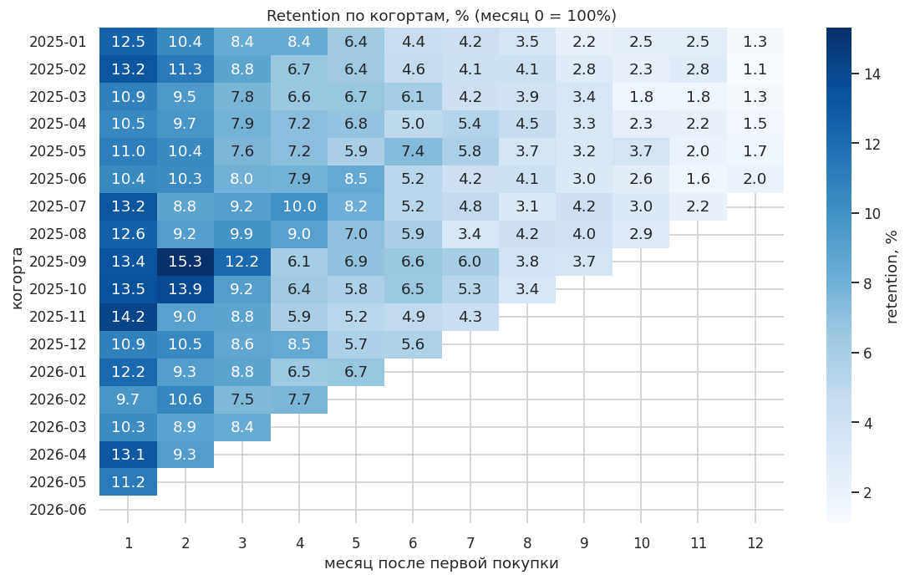
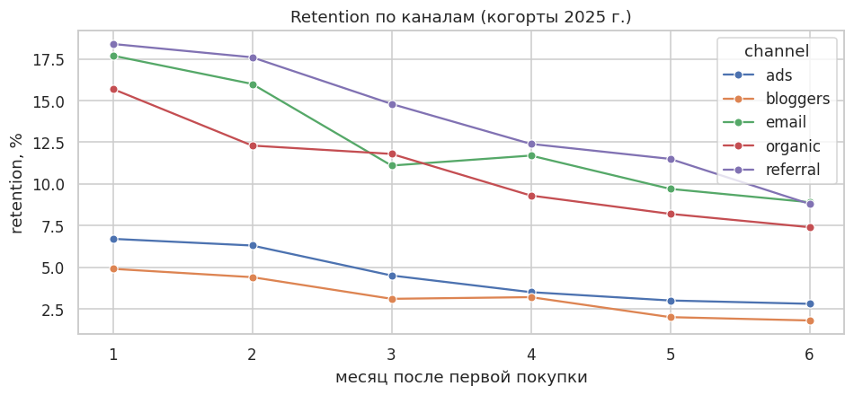
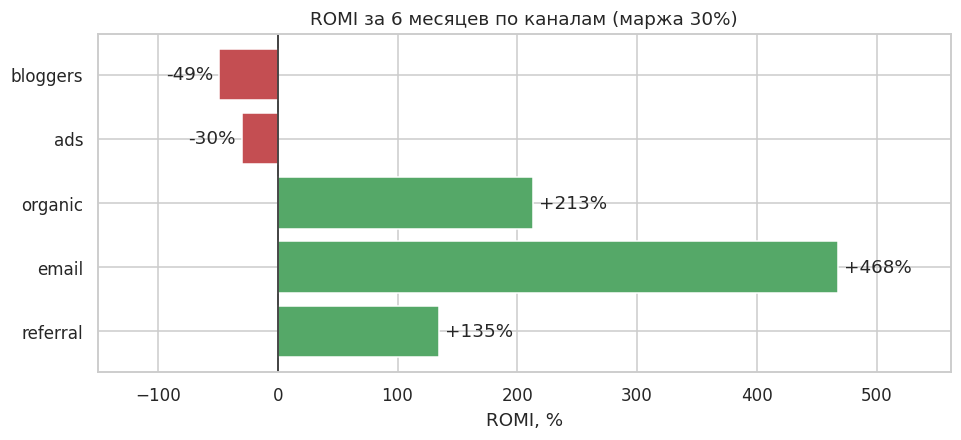

# Когорты, RFM и LTV клиентов интернет-магазина (SQL + Python)

Ответ на вопросы бизнеса: возвращаются ли клиенты, из каких каналов приходят ценные покупатели
и как сегментировать базу для CRM-рассылок.
Все расчёты сделаны **SQL-запросами** к базе SQLite, визуализация на Python.
Полный разбор лежит в [`notebooks/cohorts_rfm_ltv.ipynb`](notebooks/cohorts_rfm_ltv.ipynb).

## Главные выводы

- Выручка за 1,5 года выросла в 2,5 раза, но **только ~12% клиентов возвращаются** через месяц. Рост держится на привлечении новых.
- Клиенты из **рефералов, email и органики** возвращаются в 2–3 раза чаще, чем из рекламы и от блогеров.
- **Реклама и блогеры не окупаются за 6 месяцев** (ROMI −30% и −49%), email и рефералы окупаются многократно.
- «Лояльные» и «Чемпионы» — это 25% клиентов и 45% выручки. Для каждого RFM-сегмента предложены CRM-механики.



| Retention по каналам | ROMI по каналам |
|---|---|
|  |  |

## SQL-запросы

| Файл | Что считает | Техники |
|---|---|---|
| [`01_monthly_metrics.sql`](sql/01_monthly_metrics.sql) | выручка, заказы, средний чек, рост MoM | CTE, `LAG`, `WINDOW` |
| [`02_cohort_retention.sql`](sql/02_cohort_retention.sql) | retention по когортам | несколько CTE, работа с датами |
| [`03_rfm.sql`](sql/03_rfm.sql) | RFM-скоринг и сегменты | `NTILE`, `CASE` |
| [`04_channel_ltv.sql`](sql/04_channel_ltv.sql) | LTV за 6 мес. и повторные покупки по каналам | JOIN с условием по дате |

Выгрузки для дашборда в Power BI лежат в `exports/*.csv`.

## Структура базы

```
customers(customer_id PK, signup_date, channel, city)
orders(order_id PK, customer_id FK, order_date, amount, status)   -- status: delivered | cancelled
```
21 тыс. клиентов и 31,5 тыс. заказов, январь 2025 – июнь 2026.

## Как запустить

```bash
pip install -r requirements.txt
python src/generate_data.py      # пересоздать базу (необязательно, она уже в data/)
jupyter notebook notebooks/cohorts_rfm_ltv.ipynb
```

Данные **синтетические** и воспроизводимые (seed = 7): удержание и чеки зависят от канала, есть сезонность и отмены.
Стоимость привлечения (CAC) по каналам — это допущение, оно явно указано в ноутбуке.

## Стек

SQL (SQLite) · Python · pandas · matplotlib · seaborn · Power BI (выгрузки)
